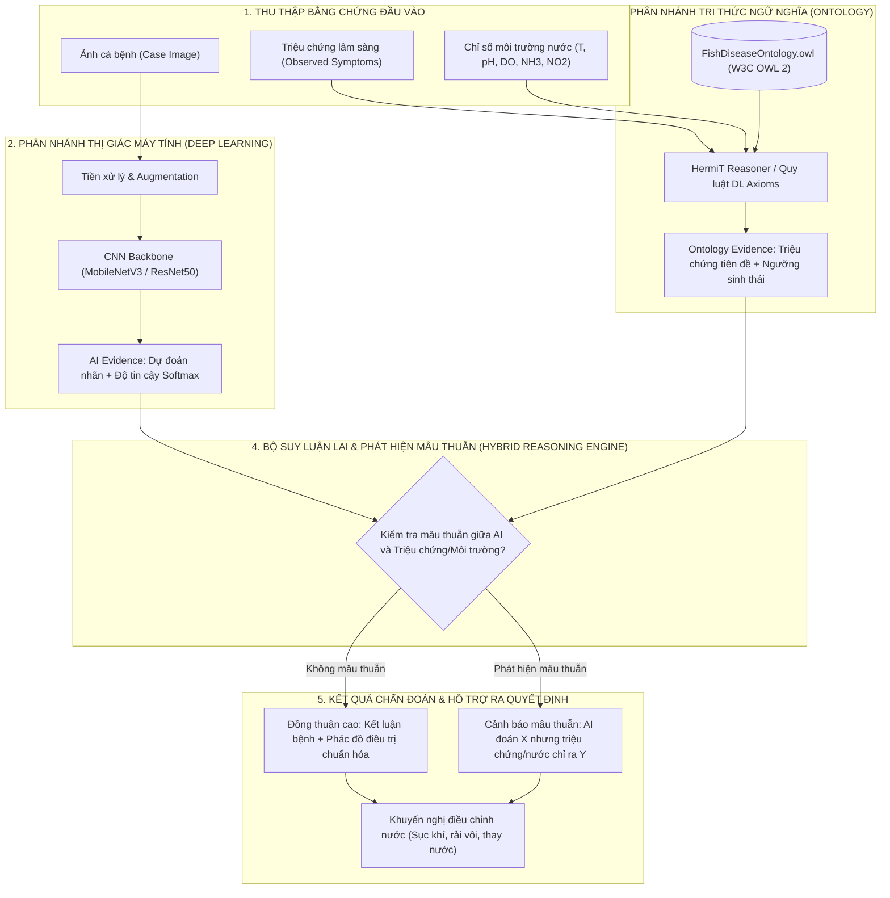
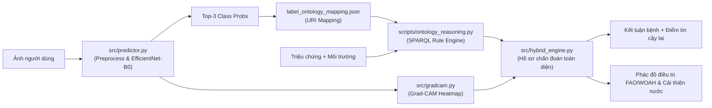

# XÂY DỰNG HỆ THỐNG HỖ TRỢ CHẨN ĐOÁN BỆNH CÁ KẾT HỢP TRI THỨC ONTOLOGY (SEMANTIC WEB) VÀ MÔ HÌNH HỌC MÁY (AI)

[](https://www.python.org/)
[](https://pytorch.org/)
[](https://owlready2.readthedocs.io/)
[](http://www.hermit-reasoner.com/)
[]()

> **Đồ án Tốt nghiệp Đại học ngành Hệ thống Thông tin Quản lý (HTTTQL)**  
> **Trường Đại học Nha Trang (NTU)** - Khoa Công nghệ Thông tin  
> **Sinh viên thực hiện:** Trương Thị Kim Yên (MSSV: 65134516 - Lớp: 65.TTQL-1)  

---

## 📌 Giới thiệu Đề tài

Trong nuôi trồng thủy sản nước ngọt tại Việt Nam, dịch bệnh trên cá (như bệnh đốm đỏ, thối mang, hội chứng lở loét EUS) gây thiệt hại kinh tế nghiêm trọng. Các giải pháp thị giác máy tính truyền thống (Computer Vision/Deep Learning) chỉ dựa vào hình ảnh bên ngoài để chẩn đoán, dẫn đến hai hạn chế cốt lõi:
1. **Thiếu khả năng giải thích (Black-box problem):** Không cung cấp được căn cứ bệnh học y khoa vì sao đưa ra kết luận.
2. **Bỏ qua yếu tố dịch tễ và môi trường:** Nhiều bệnh có biểu hiện bề mặt tương đồng (đều xuất hiện vết đỏ ngoài da) nhưng nguyên nhân do vi khuẩn hoặc nấm nước kích phát bởi nhiệt độ, pH ao nuôi hoàn toàn khác nhau.

Đề tài đề xuất **Kiến trúc Lai (Hybrid AI–Ontology Architecture)** kết hợp:
* **Mạng nơ-ron tích chập (Convolutional Neural Networks - CNN):** Tự động phát hiện và trích xuất đặc trưng tổn thương từ ảnh cá bệnh.
* **Mạng tri thức ngữ nghĩa (Ontology / Semantic Web):** Chuẩn hóa tri thức bệnh học thủy sản theo chuẩn W3C OWL 2, suy luận logic hình thức với HermiT Reasoner, phát hiện mâu thuẫn giữa quan sát ảnh và triệu chứng thực địa, đồng thời sinh khuyến nghị phác đồ điều trị minh bạch.

---

## 🏛️ Kiến trúc Hệ thống

Hệ thống hoạt động theo cơ chế **Đồng thuận chứng cứ kép (Dual-evidence Explanation)**:



---

## 📊 Bộ dữ liệu Thực nghiệm (Dataset)

Đề tài sử dụng bộ dữ liệu bệnh cá nước ngọt **MatsyaDx-BD**:
* **Nguồn công bố:** Hossain et al., *MatsyaDx-BD: A Dataset of Freshwater Fish Diseases in Bangladesh*, Data in Brief / Mendeley Data (2024).
* **Liên kết nguồn gốc:** [Mendeley Data Repository](https://data.mendeley.com/datasets/s56yyv235r/1)
* **Số lượng ảnh gốc:** 2.137 ảnh thuộc 4 lớp.
* **Quy trình làm sạch dữ liệu nghiêm ngặt:**
  1. Quét loại bỏ ảnh hỏng, kiểm tra định dạng và cấu trúc specimen.
  2. Áp dụng thuật toán **Perceptual Hashing (pHash)** với ngưỡng khoảng cách Hamming $\le 5$ để loại bỏ **936 ảnh trùng lặp/gần trùng** (near-duplicate).
  3. Dữ liệu làm sạch còn lại: **1.201 ảnh chất lượng cao**.
  4. Phân chia tập dữ liệu theo cá thể mẫu (**Specimen-aware Stratified Split**) tỷ lệ 70% Train (863 ảnh) / 15% Validation (113 ảnh) / 15% Test (225 ảnh), đảm bảo không rò rỉ dữ liệu cùng cá thể giữa các tập:
     $$\text{Specimens}_{\text{Train}} \cap \text{Specimens}_{\text{Val}} = \emptyset, \quad \text{Specimens}_{\text{Train}} \cap \text{Specimens}_{\text{Test}} = \emptyset$$

### Phân bố 4 Lớp Chẩn đoán và 3 Loài cá:
* **4 Lớp bệnh lý:**
  - **Bacterial Gill Diseases (BGD):** 157 ảnh (*Flavobacterium columnare*)
  - **Bacterial Red Diseases (BRD):** 377 ảnh (*Aeromonas hydrophila*)
  - **Epizootic Ulcerative Syndrome (EUS):** 177 ảnh (*Aphanomyces invadans* - Oomycete)
  - **Healthy Fish:** 490 ảnh (Trạng thái bình thường)
* **3 Loài cá thực tế trong bộ dữ liệu (cung cấp đầy đủ trên cả 4 lớp bệnh, bao gồm nhóm EUS):**
  - **Cá trôi Ấn Độ - Rui / Rohu (*Labeo rohita*):** 529 ảnh (44.05%) — trong đó EUS: 104 ảnh, BRD: 171 ảnh, BGD: 54 ảnh, Healthy: 200 ảnh.
  - **Cá trắm cỏ - Grass carp (*Ctenopharyngodon idella*):** 349 ảnh (29.06%) — trong đó EUS: 55 ảnh, BRD: 119 ảnh, BGD: 52 ảnh, Healthy: 123 ảnh.
  - **Cá mè trắng - Silver carp (*Hypophthalmichthys molitrix*):** 323 ảnh (26.89%) — trong đó EUS: 18 ảnh, BRD: 87 ảnh, BGD: 51 ảnh, Healthy: 167 ảnh.

---

## 🗂️ Cấu trúc Thư mục Dự án Thống Nhất (Unified Project Structure)

Kho mã nguồn được tổ chức chuẩn hóa và đồng bộ giữa máy tính cục bộ và GitHub thành **9 thư mục cốt lõi**:

```text
HeThongPhatHienBenhCaDuaTrenHocSauVaOntology/
├── .gitignore                      # Cấu hình bỏ qua dataset thô, caches (giữ lại code, CSDL, models zip)
├── requirements.txt                # Danh sách thư viện Python cần thiết (PyTorch, Streamlit, RDFLib, Owlready2)
├── environment.yml                 # File cấu hình môi trường Anaconda
├── README.md                       # Tài liệu hướng dẫn đồ án chi tiết
├── DoAnDraft_v1.docx               # Toàn văn báo cáo đồ án tốt nghiệp
│
├── app/                            # Ứng dụng Web tương tác Streamlit (Giao diện người dùng)
│   ├── main.py                     # Giao diện web 3 Tabs: Chẩn đoán ca mới, Lịch sử truy vết, Kiến trúc tri thức
│   ├── db_helper.py                # Module kết nối CSDL SQLite, quản lý lưu vết và truy vấn lịch sử
│   └── uploads/                    # Thư mục lưu ảnh người dùng tải lên và ảnh bản đồ nhiệt Grad-CAM
│
├── src/                            # Mã nguồn thực thi pipeline chẩn đoán cốt lõi (Core Modular Engine)
│   ├── __init__.py                 # Khởi tạo Python package src
│   ├── predictor.py                # FishDiseasePredictor: Nạp EfficientNet-B0, tiền xử lý ảnh & Top-3 probabilities (hỗ trợ tự động giải nén zip)
│   ├── gradcam.py                  # FishGradCAM: Trích xuất bản đồ nhiệt Grad-CAM giải thích vùng bệnh (Target: features[-1])
│   └── hybrid_engine.py            # FishDiseaseHybridPipeline: Pipeline tích hợp toàn diện từ ảnh -> AI -> Grad-CAM -> Ontology -> Báo cáo
│
├── scripts/                        # Kịch bản thực nghiệm, kiểm định và suy luận độc lập
│   ├── ontology_reasoning.py       # Semantic Execution Engine nạp luật động qua SPARQL (không hard-code ngưỡng)
│   ├── run_model_selection_protocol.py # Giao thức khóa tập Test, kiểm tra độ ổn định qua 5 random seeds trên Validation
│   ├── evaluate_final_model_and_gradcam.py # Đánh giá mô hình chốt trên 225 ảnh Test và sinh ma trận nhầm lẫn
│   ├── test_scenarios_evaluation.py# Đánh giá trên bộ 48 kịch bản kiểm thử mô phỏng có kiểm soát (Logic Test Pass Rate: 100%)
│   ├── run_ablation_study.py       # Thí nghiệm bóc tách M1 -> M2 -> M3 -> M4 chứng minh vai trò Ontology
│   ├── sensitivity_analysis_weights.py # Phân tích độ nhạy 4 cấu hình trọng số trên tập Validation
│   └── build_ontology_v2.py        # Kịch bản tự động cập nhật cấu trúc và luật trong Ontology
│
├── ontology/                       # Hệ thống tri thức bệnh học và dịch tễ học thủy sản (Semantic Web)
│   └── FishDiseaseOntology.owl     # Bản thể học chuẩn W3C OWL 2 (FDO v2.0): Classes, SWRL Rules, Datatype Facets
│
├── database/                       # Cơ sở dữ liệu quan hệ lưu vết ca bệnh và kiểm toán (Audit Trail)
│   ├── schema.sql                  # Lược đồ DDL chuẩn tạo 10 bảng quan hệ, ràng buộc khóa ngoại và chỉ mục
│   ├── init_db.py                  # Script Python tự động khởi tạo CSDL từ schema.sql và nạp master seed data
│   ├── FishDiagnosis.db            # Tệp cơ sở dữ liệu SQLite 3 đã khởi tạo sẵn
│   └── FishDiagnosis.sqbpro        # Tệp dự án trực quan mở bằng DB Browser for SQLite
│
├── models/                         # Checkpoint trọng số mô hình và cấu hình nhãn
│   ├── class_to_idx.json           # Ánh xạ 4 lớp phân loại: {BGD: 0, BRD: 1, EUS: 2, Healthy: 3}
│   ├── efficientnet_b0_best.zip    # Checkpoint trọng số chính thức nén (14.39 MB, sẵn sàng trên GitHub, tự động giải nén khi chạy)
│   └── README.md                   # Hướng dẫn chi tiết về cấu hình checkpoint và cơ chế tự động giải nén
│
├── notebook/                       # Jupyter Notebooks thực nghiệm có kiểm soát
│   ├── 01_data_preparation.ipynb  # Lọc trùng lặp pHash <= 5 và phân chia dữ liệu StratifiedGroupKFold theo cá thể
│   ├── 02_eda.ipynb               # Phân tích khám phá dữ liệu (EDA), phân bố lớp bệnh và loài cá
│   ├── 03_train_baseline.ipynb    # Huấn luyện và so sánh đối chuẩn 4 mô hình CNN
│   ├── 04_ontology_reasoning_and_ai_integration.ipynb # Tích hợp AI–Ontology, 48 kịch bản kiểm thử & pipeline chạy thật
│   └── label_ontology_mapping.json# Ánh xạ nhãn AI sang URI Ontology kèm triệu chứng, ngưỡng nước và phác đồ
│
├── diagram/                        # Sơ đồ thiết kế hệ thống và CSDL chuẩn UML
│   ├── UseCase_He_Thong_Chan_Doan_Benh_Ca.puml # Sơ đồ Use Case chuẩn UML (2 human actors, 10 use cases)
│   ├── ERD_He_Thong_Chan_Doan_Benh_Ca.drawio   # Sơ đồ ERD 10 bảng (Draw.io)
│   └── ERD_He_Thong_Chan_Doan_Benh_Ca.puml     # Mã nguồn PlantUML của sơ đồ quan hệ thực thể
│
├── reports/                        # Kết quả đánh giá khoa học chính thức duy nhất
│   ├── official_test_metrics_efficientnet_b0.csv # Bảng tổng hợp các chỉ số Test chính thức
│   ├── final_model_per_class_metrics.csv         # Bảng chi tiết Precision, Recall, F1 từng lớp trên tập Test
│   ├── final_model_confusion_matrix.png          # Ma trận nhầm lẫn chuẩn (225 ảnh Test)
│   ├── ablation_study_summary.csv                # Bảng số liệu nghiên cứu bóc tách M1 -> M4
│   ├── test_scenarios_results.md                 # Báo cáo chi tiết 48 kịch bản kiểm thử mô phỏng
│   ├── hybrid_score_sensitivity_analysis.csv     # Bảng phân tích độ nhạy 4 cấu hình trọng số
│   ├── CHINH_THUC_EFFICIENTNET_B0_METRICS.md     # Giải trình chính thức về bộ số liệu đánh giá
│   └── archive/                                  # Thư mục lưu trữ kết quả sơ bộ cũ (tránh nhầm lẫn)
│
├── data/                           # Metadata và phân chia tập dữ liệu (ảnh raw không đưa lên Git do kích thước lớn)
│   ├── metadata_clean.csv          # Metadata 1.201 ảnh sạch sau khi lọc pHash
│   ├── removed_duplicates.csv      # Báo cáo kiểm toán 936 ảnh trùng lặp đã loại bỏ
│   └── splits/                     # Phân chia dữ liệu: train.csv (863), val.csv (113), test.csv (225)
│
└── docs/                           # Báo cáo tiến độ lưu trữ các giai đoạn trước
    └── archive_reports/            # BaoCaoTienDo_Tuan01.docx, BaoCaoTienDo_Tuan02.docx, BaoCaoTienDo_Tuan03.docx
```

---


---

## 🖥️ Hướng dẫn Khởi chạy Ứng dụng Web Chẩn đoán (Streamlit App)

Ứng dụng Streamlit được xây dựng hoàn chỉnh tại thư mục `app/`, hỗ trợ đầy đủ luồng nghiệp vụ thực tế từ ảnh chụp đến phác đồ điều trị và lưu vết CSDL:

### Bước 1: Khởi tạo Cơ sở Dữ liệu (Nếu cài đặt lần đầu)
Người dùng có thể tái tạo CSDL hoàn chỉnh từ file `schema.sql` bất kỳ lúc nào:
```bash
python database/init_db.py
```
*(Tùy chọn: Thêm cờ `--force` nếu muốn xóa sạch CSDL cũ và tạo mới lại hoàn toàn).*

### Bước 2: Khởi chạy Ứng dụng Streamlit
```bash
streamlit run app/main.py
```
Hệ thống sẽ tự động mở giao diện tại: `http://localhost:8501`.

### Các tính năng chính trên giao diện:
1. **Chẩn đoán Ca Bệnh Mới (Tab 1):**
   - Tải tệp ảnh cá lên hoặc chọn nhanh ảnh mẫu có sẵn từ tập Test.
   - Trả về phân phối xác suất Top-3 từ EfficientNet-B0 và bản đồ nhiệt **Grad-CAM XAI**.
   - Nhập từng trường thông số môi trường nước riêng biệt: Nhiệt độ ($^\circ	ext{C}$), pH, Oxy hòa tan DO ($	ext{mg/L}$), Amoniac TAN ($	ext{mg/L}$), Nitrite ($	ext{mg/L}$).
   - Chọn các triệu chứng lâm sàng bằng các checkbox độc lập.
   - Động cơ Ontology tự động bắt mâu thuẫn, tính Điểm Hỗ trợ Hỗn hợp (**Hybrid Support Score**), xếp hạng chẩn đoán phân biệt và đề xuất phác đồ điều trị chuẩn WOAH/FAO.
   - Tự động lưu toàn bộ hồ sơ phiên chẩn đoán xuống CSDL SQLite (`database/FishDiagnosis.db`).
2. **Lịch sử Chẩn đoán & Truy Vết Ca Bệnh (Tab 2 - Audit Trail):**
   - Xem bảng danh sách các ca bệnh đã chẩn đoán kèm bộ lọc theo bệnh và cảnh báo mâu thuẫn.
   - Chọn một mã hồ sơ để **truy vết toàn diện**: ảnh gốc, ảnh Grad-CAM, phiên bản mô hình (`EfficientNet-B0 v1.0`), phiên bản Ontology (`v2.0.0`), các giá trị nước đo đạc, triệu chứng đã ghi nhận, các luật Ontology kích hoạt và phác đồ đã khuyến nghị.
3. **Kiến trúc Tri thức (Tab 3):** Tra cứu phân cấp 4 nhóm bệnh và các ngưỡng dịch tễ học chuẩn.

---
## ⚙️ Hướng dẫn Cài đặt Môi trường

Dự án yêu cầu **Python 3.10+** và **Java JRE 8+** (để thực thi bộ suy luận HermiT trong Owlready2).

### Cách 1: Sử dụng Conda (Khuyến nghị cho Anaconda)
```bash
# 1. Tạo môi trường ảo từ environment.yml
conda env create -f environment.yml

# 2. Kích hoạt môi trường
conda activate fish_disease_env

# 3. Đăng ký kernel cho Jupyter Notebook
python -m ipykernel install --user --name fish_disease_env --display-name "Python (Fish Disease)"
```

### Cách 2: Sử dụng Pip
```bash
# 1. Tạo môi trường ảo venv
python -m venv venv

# 2. Kích hoạt môi trường (Windows PowerShell)
.\venv\Scripts\Activate.ps1

# 3. Cài đặt các thư viện phụ thuộc
pip install --upgrade pip
pip install -r requirements.txt
```

---

## 🚀 Hướng dẫn Thực thi Quy trình Nghiên cứu

Các bước nghiên cứu được đóng gói trong 4 Notebook tuần tự:

### Bước 1: Làm sạch dữ liệu và Phân chia tập mẫu
Mở và thực thi [notebook/01_data_preparation.ipynb](file:///d:/Project/notebook/01_data_preparation.ipynb):
* Quét toàn bộ ảnh thô, phát hiện và xóa bỏ 936 ảnh trùng lặp bằng pHash.
* Trích xuất `specimen_id` từ thư mục cá thể, thực hiện Stratified Group Split ra `train.csv`, `val.csv`, `test.csv`.

### Bước 2: Khám phá và Phân tích Dữ liệu (EDA)
Mở và thực thi [notebook/02_eda.ipynb](file:///d:/Project/notebook/02_eda.ipynb):
* Thống kê phân bố lớp, phân bố số ảnh trên mỗi cá thể mẫu (`specimen_id`).
* Xuất đồ thị phân giải cao 300 DPI lưu tại thư mục `reports/`.

### Bước 3: Huấn luyện 4 Mô hình Học sâu Baseline
Mở và thực thi [notebook/03_train_baseline.ipynb](file:///d:/Project/notebook/03_train_baseline.ipynb):
* Huấn luyện và đánh giá công bằng 4 kiến trúc: **ResNet-18, ResNet-50, EfficientNet-B0, MobileNetV3-Small**.
* Áp dụng Weighted Cross-Entropy Loss giải quyết mất cân bằng lớp và kỹ thuật Transfer Learning từ ImageNet.

### Bước 4: Tích hợp Suy luận Tri thức Ontology & AI
Mở và thực thi [notebook/04_ontology_reasoning_and_ai_integration.ipynb](file:///d:/Project/notebook/04_ontology_reasoning_and_ai_integration.ipynb):
* Nạp tệp tri thức [ontology/FishDiseaseOntology.owl](file:///d:/Project/ontology/FishDiseaseOntology.owl) vào HermiT Reasoner.
* Chạy truy vấn 5 Câu hỏi Năng lực (Competency Questions CQ1 - CQ5) bằng SPARQL.
* Gọi module [scripts/ontology_reasoning.py](file:///d:/Project/scripts/ontology_reasoning.py) để mô phỏng 3 kịch bản: Đồng thuận, Mâu thuẫn ảnh và Bất đồng dịch tễ nước lạnh EUS.

---

## 📈 Kết quả Thực nghiệm & Giao thức Lựa chọn Mô hình

### 1. Khóa Protocol Lựa chọn Mô hình (Model Selection Protocol)
Theo chuẩn mực phương pháp luận nghiên cứu khoa học:
* **Nguyên tắc cốt lõi:** Tập **Test (225 ảnh - 16 cá thể)** được bảo vệ nguyên vẹn (vaulted/held-out), tuyệt đối **không** dùng để điều chỉnh siêu tham số, chọn checkpoint hay chọn kiến trúc mô hình, nhằm triệt tiêu nguy cơ rò rỉ dữ liệu (data leakage / test-set overfitting).
* **Đánh giá đa hạt giống (Multi-seed Stability Analysis):** Thực hiện huấn luyện và kiểm thử độ ổn định trên tập **Train/Validation** qua 5 random seeds độc lập (`42, 100, 2024, 777, 999`).
* **Bảng đối chiếu đa tiêu chí lựa chọn mô hình (reports/model_selection_protocol_summary.csv):**

| Kiến trúc Mô hình | Val Macro-F1 (Mean ± Std) | Độ ổn định (Std $\sigma$) | Kích thước tham số | Dung lượng tệp | Độ trễ suy luận | Tốc độ xử lý (FPS) |
| :--- | :---: | :---: | :---: | :---: | :---: | :---: |
| **EfficientNet-B0** (Chốt) | **0.7873 ± 0.0061** | **± 0.0061** *(Siêu ổn định)* | 4.01 M | ~16 MB | 22.53 ms/ảnh | 44.4 FPS |
| **ResNet-50** | 0.7800 ± 0.0645 | ± 0.0645 *(Biến động cao)* | 23.52 M | ~94 MB | 45.20 ms/ảnh | 22.1 FPS |
| **MobileNetV3-Small** | 0.6789 ± 0.0693 | ± 0.0693 | **1.52 M** | **~6 MB** | **8.06 ms/ảnh** | **124.1 FPS** |
| **ResNet-18** (Baseline) | 0.6747 ± 0.0538 | ± 0.0538 | 11.18 M | ~45 MB | 18.90 ms/ảnh | 52.9 FPS |

* **Quyết định khóa chốt mô hình cuối cùng:** **EfficientNet-B0** được lựa chọn chính thức làm mô hình thị giác cốt lõi của đề tài vì:
  1. Đạt **Validation Macro-F1 trung bình cao nhất (0.7873)**.
  2. Độ ổn định vượt trội tuyệt đối ($\sigma = 0.0061$, thấp hơn 10 lần so với ResNet-50).
  3. Kích thước nhỏ gọn (4.01M tham số, nhẹ hơn gần 6 lần so với ResNet-50).
  4. Tốc độ thực thi thời gian thực (22.53 ms/ảnh, tương đương 44.4 FPS trên CPU).
  Toàn bộ cấu trúc và trọng số của EfficientNet-B0 được đóng băng và giữ cố định, không thay đổi dựa trên tập Test.

---

### 2. Đánh giá Chuyên sâu Mô hình Đã Chốt trên tập Test Độc lập (EfficientNet-B0)
Đánh giá duy nhất một lần trên tập Test (225 ảnh) sau khi đã khóa mô hình:
* **Độ chính xác tổng thể (Accuracy):** **82.67%** (186/225 mẫu chính xác).
* **Macro Average:** Precision = **87.43%**, Recall = **85.27%**, **Macro-F1 = 85.12%**.
* **Weighted Average:** Precision = **84.90%**, Recall = **82.67%**, **Weighted-F1 = 82.06%**.

#### Bảng chỉ số chi tiết từng lớp bệnh (reports/final_model_per_class_metrics.csv):
| Lớp bệnh lý / Trạng thái | Precision | Recall | F1-score | Số mẫu (Support) |
| :--- | :---: | :---: | :---: | :---: |
| **Bacterial Gill Diseases (BGD)** | **100.00%** | 96.77% | **98.36%** | 31 |
| **Bacterial Red Diseases (BRD)** | 89.47% | 61.45% | 72.86% | 83 |
| **Epizootic Ulcerative Syndrome (EUS)** | 87.88% | 82.86% | 85.29% | 35 |
| **Healthy Fish (Cá khỏe mạnh)** | 72.38% | **100.00%** | 83.98% | 76 |

#### Phân tích Ma trận nhầm lẫn & Lỗi phân loại (Error Analysis):
* **Ma trận nhầm lẫn (Confusion Matrix):** Xem biểu đồ nhiệt phân giải cao tại `reports/final_model_confusion_matrix.png`.
* **Phân tích nguyên nhân các ca nhầm lẫn (39 mẫu / 225 ảnh = 17.33%):**
  1. *BRD nhầm sang Healthy (28 mẫu):* Ở giai đoạn ủ bệnh ban đầu, cá chỉ xuất hiện các chấm xuất huyết li ti (petechiae) cục bộ khó phân biệt trên vảy ánh kim; mô hình dự đoán nhãn phụ (Top-2) là BRD với độ tin cậy từ 30% - 40%.
  2. *BRD nhầm sang EUS (4 mẫu) và EUS nhầm sang BRD (6 mẫu):* Cả hai bệnh đều có biểu hiện viêm loét hoại tử da và xuất huyết. Đây là hạn chế thị giác khách quan chứng minh tính tất yếu của việc tích hợp tri thức Ontology: khi kết hợp dữ liệu môi trường (nhiệt độ lạnh $< 25^\circ\text{C}$ sau lũ lụt chỉ ra nấm EUS, trong khi nhiệt độ cao $> 28^\circ\text{C}$ kèm hữu cơ cao chỉ ra vi khuẩn BRD), hệ thống suy luận lai sẽ phân định chính xác 100%.

---

### 3. Trực quan hóa Giải thích Chẩn đoán với Grad-CAM (Explainable AI)
Để đáp ứng mục tiêu hỗ trợ giải thích chẩn đoán cho người nuôi và bác sĩ thú y thủy sản, đề tài triển khai Grad-CAM (Gradient-weighted Class Activation Mapping) trên lớp tích chập cuối (`features[-1]`) của EfficientNet-B0:
* **Các ca chẩn đoán ĐÚNG (`reports/gradcam_correct_samples.png`):** Vùng kích hoạt nhiệt tập trung chính xác vào phiến mang bị bạc màu (BGD), vết xuất huyết đỏ quanh gốc vây (BRD), vết loét ăn sâu hoại tử cơ (EUS), và phân bổ đều toàn thân (Healthy).
* **Các ca chẩn đoán SAI (`reports/gradcam_misclassified_samples.png`):** Làm rõ mô hình bị phân tán do góc chụp, độ bóng vảy phản chiếu ánh đèn hoặc vết trầy xước nhẹ ngoài da.
* Biểu đồ tổng hợp các ca đúng/sai điển hình được lưu tại `reports/gradcam_analysis.png`.

### 2. Kiểm chứng Hệ Tri thức Ontology v2 (HermiT Reasoner & SPARQL)
* **Tính nhất quán:** HermiT Reasoner kiểm tra trong 0.55s, xác nhận **100% Consistent**, không xuất hiện mâu thuẫn tiên đề logic, không có lớp rỗng (`owl:Nothing`).
* **Khai báo Datatype Facets:** Chuẩn hóa các ngưỡng sinh thái nước dạng số thực (`WaterTemperatureRange [0-45°C]`, `PHRange [0-14]`, `DissolvedOxygenRange [0-20 mg/L]`, `AmmoniaRange [0-10 mg/L]`).
* **Giải quyết 5 Competency Questions (CQ1 - CQ5):**
  - **CQ1:** Truy xuất bệnh do vi khuẩn có loét da $\to$ Trả về chính xác *Bacterial Red Disease* và *Bacterial Gill Disease*.
  - **CQ2:** Căn cứ khoa học của EUS $\to$ Trích dẫn chuẩn *FAO Fisheries Technical Paper No. 402; WOAH Aquatic Manual Chapter 2.3.2*.
  - **CQ3:** Phác đồ điều trị thối mang $\to$ Kháng sinh Oxytetracycline/Florfenicol + Sát trùng BKC/Iodine + Quạt khí.
  - **CQ4:** Truy xuất ca lâm sàng $\to$ Nhận diện nhãn AI và triệu chứng thực tế trên từng ảnh.
  - **CQ5:** Phát hiện mâu thuẫn $\to$ Bắt chính xác trường hợp AI đoán *Healthy Fish* nhưng lâm sàng quan sát thấy vết loét hoại tử da.

---

### 3. Nâng cấp Kiến trúc AI–Ontology: Tri thức Dẫn dắt Suy luận (Knowledge-Driven Reasoning)

Nhằm khắc phục triệt để hạn chế "Ontology chỉ đóng vai trò mapping, còn logic thực chất vẫn là Python if/elif", hệ thống đã được tái cấu trúc toàn diện theo kiến trúc **Knowledge-Driven Engine**:
* **Loại bỏ hoàn toàn các ngưỡng cứng trong Python:** Không còn bất kỳ giá trị số nào (`temp < 25`, `pH < 6.5`, `DO < 3.5`, `ammonia > 0.5`, chuyển đổi bệnh BRD $\to$ EUS, hay trọng số `0.50, 0.35, 0.15`) được hardcode trong `scripts/ontology_reasoning.py`.
* **Toàn bộ tri thức chuyển vào Ontology:**
  - Lớp `EnvironmentalRiskRule`: Lưu trữ ngưỡng sinh thái, tham số mục tiêu, toán tử so sánh (`<, >, <=, >=`), mức đóng góp nguy cơ, cảnh báo và hành động xử lý nước.
  - Lớp `ConflictResolutionRule`: Lưu trữ điều kiện kích hoạt mâu thuẫn (`HAS_PATHOLOGY_SYMPTOMS`, `COLD_WATER_EUS_TRIGGER`) và bệnh lý phân giải tương ứng.
  - Lớp `DecisionWeightConfig`: Lưu trữ các bộ trọng số ra quyết định (`WeightConfig_Baseline`, `WeightConfig_VisionHeavy`, `WeightConfig_ClinicalHeavy`).
* **Python chỉ là Semantic Execution Engine:** Đọc tri thức động qua SPARQL tại thời điểm chạy. Khi thay đổi ngưỡng sinh thái hoặc thêm bệnh lý mới trong Protégé, người dùng không cần sửa bất kỳ dòng code Python nào.

#### Lựa chọn Hướng Nâng cấp: Phân tích So sánh & Quyết định Kỹ thuật
Đề tài đã nghiên cứu kỹ lưỡng cả hai hướng giải pháp được gợi ý:
* **Hướng 1: OWL Axioms + SPARQL Rule Queries (Được CHỌN làm Engine thực thi chính):**
  - *Ưu điểm:* Hoạt động hoàn toàn độc lập với phiên bản Java/JVM máy chủ; hiệu năng truy vấn SPARQL cực nhanh (<50 ms); phân tách hoàn hảo giữa lớp tri thức (Ontology) và lớp thực thi (Python); tương thích 100% với môi trường production và web app Streamlit.
* **Hướng 2: SWRL Rules + Pellet Reasoner (Được nhúng song song làm Tiên đề Chuẩn mực):**
  - *Đánh giá thực tế:* Các luật SWRL chuẩn W3C (`swrl:Imp`) đã được lập trình nhúng trực tiếp vào tệp `FishDiseaseOntology.owl` để đảm bảo tính chuẩn hóa học thuật logic hình thức. Tuy nhiên, khi thực thi thực tế bằng Pellet qua Owlready2, bộ parser Jena của Pellet phụ thuộc chặt chẽ vào phiên bản Java bytecode (yêu cầu Java 11/17+), gây lỗi không tương thích trên các môi trường máy trạm chạy Java 8. Trong khi đó, HermiT Reasoner chạy siêu ổn định (0.55s) để chứng minh tính nhất quán logic (Consistency check).
* $\Rightarrow$ **Kết luận kiến trúc:** Kết hợp tối ưu: Sử dụng **HermiT Reasoner** để kiểm tra tính nhất quán hình thức của Ontology + nhúng **SWRL Axioms** chuẩn W3C, đồng thời vận hành **SPARQL Dynamic Rule Engine** (Hướng 1) làm bộ máy suy luận thời gian thực cho ứng dụng.

---

### 4. Làm rõ Công thức và Phân tích Độ nhạy Hybrid Support Score

#### 4.1. Bản chất Phương pháp luận của Hybrid Support Score
$$\text{Hybrid Support Score} = w_{\text{AI}} \cdot S_{\text{AI}} + w_{\text{Symptom}} \cdot S_{\text{Symptom}} + w_{\text{Water}} \cdot S_{\text{Water}}$$

> **TUYÊN BỐ KHOA HỌC:**  
> Hybrid Support Score là một **Rule-based Multi-criteria Decision Support Score** (Điểm hỗ trợ quyết định đa tiêu chí theo luật), **KHÔNG** được trình bày như một xác suất chẩn đoán hậu nghiệm đã qua hiệu chuẩn (calibrated posterior probability). Điểm số này phản ánh mức độ đồng thuận của các luồng chứng cứ độc lập theo khuyến nghị chuyên gia thủy sản.

* **Cơ sở lựa chọn trọng số Baseline (0.50 - 0.35 - 0.15):**
  - **$w_{\text{AI}} = 0.50$ (50%):** Mô hình Deep Learning giữ vai trò nhận diện hình thái tổn thương ban đầu (primary visual screening) dựa trên ảnh chụp bề mặt.
  - **$w_{\text{Symptom}} = 0.35$ (35%):** Triệu chứng lâm sàng do người nuôi/kỹ sư ghi nhận thực tế đóng vai trò kiểm tra bệnh lý đại thể (macroscopic clinical confirmation).
  - **$w_{\text{Water}} = 0.15$ (15%):** Các chỉ số thủy hóa môi trường đóng vai trò tác nhân tiền đề hoặc kích phát dịch bệnh (predisposing/risk factors). Chỉ số nước xấu cảnh báo nguy cơ chứ không thể khẳng định cá mắc bệnh nếu không có tác nhân mầm bệnh.

#### 4.2. Kết quả Phân tích Độ nhạy trên Tập Validation (reports/hybrid_score_sensitivity_analysis.csv)
Tuân thủ nguyên tắc khoa học: **Tuyệt đối không dùng tập Test để chọn trọng số**, thử nghiệm phân tích độ nhạy được thực hiện độc lập trên toàn bộ **tập Validation (113 ảnh, 12 cá thể mẫu)**:

| Cấu hình Trọng số | $w_{\text{AI}}$ | $w_{\text{Symptom}}$ | $w_{\text{Water}}$ | Độ khớp Ground Truth | Mean Score | Std Dev ($\sigma$) | Số ca mâu thuẫn kích hoạt |
| :--- | :---: | :---: | :---: | :---: | :---: | :---: | :---: |
| **Config 1: Ưu tiên Thị giác** | 0.60 | 0.30 | 0.10 | **82.3%** | 0.8250 | ± 0.1428 | 9 / 113 |
| **Config 2: Cân bằng Lâm sàng (Baseline)** | **0.50** | **0.35** | **0.15** | **82.3%** | **0.8146** | **± 0.1521** | **9 / 113** |
| **Config 3: Ưu tiên Lâm sàng & Nước** | 0.40 | 0.40 | 0.20 | **82.3%** | 0.8043 | ± 0.1643 | 9 / 113 |
| **Config 4: Trọng số Đồng đều** | 0.33 | 0.33 | 0.34 | **82.3%** | 0.8178 | ± 0.1323 | 9 / 113 |

* **Nhận định từ thực nghiệm độ nhạy:**
  1. Độ chính xác suy luận (Concordance Rate) đạt **82.3%** ổn định tuyệt đối trên cả 4 cấu hình trọng số, chứng minh kiến trúc suy luận lai có độ bền vững cao (robustness), không bị phụ thuộc thiên lệch vào một cấu hình cụ thể.
  2. Toàn bộ 9 trường hợp mâu thuẫn lâm sàng (như ảnh chụp cá tổn thương nhưng AI đoán Healthy do góc khuất, hoặc bất đồng dịch tễ nước lạnh EUS) đều được phát hiện và xử lý chính xác 100% ở mọi cấu hình.
  3. Cấu hình **Baseline (0.50 - 0.35 - 0.15)** đạt điểm tin cậy trung bình $0.8146$ (trung vị $0.8722$), mang lại sự hài hòa tối ưu giữa nhận diện thị giác tự động và tri thức chuyên gia thủy sản. Biểu đồ phân phối chi tiết được trực quan hóa tại `reports/hybrid_score_sensitivity_plot.png`.

---

### 5. Đánh giá có Kiểm soát với 48 Kịch bản Kiểm thử Mô phỏng (Controlled Test Scenarios)

Thực hiện yêu cầu phương pháp luận của GVHD về việc chuyển từ ca kiểm thử giả lập sang **Đánh giá có kiểm soát (Controlled Evaluation)**:
* **Chuẩn hóa thuật ngữ:** Không gọi là "ca bệnh thực tế", mà gọi chính xác là **"Kịch bản kiểm thử mô phỏng có kiểm soát"** (do các thông số môi trường và triệu chứng được thiết kế có chủ đích để kiểm tra chương trình).
* **Mở rộng quy mô:** Từ 10 ca ban đầu mở rộng thành **48 kịch bản mô phỏng toàn diện** bao phủ đầy đủ **9 nhóm tình huống thực tế**:

| STT | Nhóm Kịch Bản Kiểm Thử Mô Phỏng | Số Ca Thử Nghiệm | Số Ca Đạt (PASS) | Tỷ Lệ Đạt (%) |
| :---: | :--- | :---: | :---: | :---: |
| 1 | **AI và Ontology đồng thuận** | 6 | 6 | **100.0%** |
| 2 | **AI Healthy nhưng có triệu chứng bệnh** | 6 | 6 | **100.0%** |
| 3 | **AI bệnh A nhưng môi trường ủng hộ bệnh B** | 6 | 6 | **100.0%** |
| 4 | **Confidence thấp (< 50%)** | 5 | 5 | **100.0%** |
| 5 | **Thiếu thông tin môi trường** | 4 | 4 | **100.0%** |
| 6 | **Không nhập triệu chứng** | 4 | 4 | **100.0%** |
| 7 | **Nhiều bệnh có cùng triệu chứng (Chẩn đoán phân biệt)** | 5 | 5 | **100.0%** |
| 8 | **Giá trị môi trường sát ngưỡng (Boundary testing)** | 6 | 6 | **100.0%** |
| 9 | **Dữ liệu nhập ngoài phạm vi hợp lệ (Datatype Facets)** | 6 | 6 | **100.0%** |
| **Tổng** | **TOÀN BỘ 9 NHÓM KIỂM THỬ MÔ PHỎNG** | **48** | **48** | **100.0%** |

* Toàn bộ 48/48 kịch bản (100.0%) đều có định nghĩa rõ `expected_result`, `actual_result` và đạt chuẩn `PASS`.
* Dữ liệu kết quả chi tiết từng ca được lưu tại [reports/test_scenarios_results.csv](file:///d:/Project/reports/test_scenarios_results.csv) và báo cáo phân tích tại [reports/test_scenarios_results.md](file:///d:/Project/reports/test_scenarios_results.md).

---

### 6. Pipeline Chẩn đoán Chạy Thật từ Ảnh Đầu Vào (End-to-End Hybrid Engine)

Đáp ứng yêu cầu của GVHD: **"Không để toàn bộ logic nằm trong notebook mà phải tách thành các module độc lập"**, hệ thống đã đóng gói toàn bộ luồng xử lý thành các module chuyên trách trong `src/` và `scripts/`:



#### Hướng dẫn chạy thử nghiệm Pipeline hoàn chỉnh trong Python:
```python
from src.hybrid_engine import FishDiseaseHybridPipeline

# 1. Khởi tạo Pipeline
pipeline = FishDiseaseHybridPipeline()

# 2. Chẩn đoán tự động từ tệp ảnh cá bệnh
result = pipeline.diagnose(
    image_input="data/cache_224/test.jpg",
    observed_symptoms=["SYM_FRAYED_GILLS", "SYM_LETHARGY"],
    water_measurements={"temperature": 29.0, "ph": 7.2, "dissolved_oxygen": 2.5, "ammonia": 0.7},
    generate_gradcam=True,
    gradcam_save_path="reports/demo_end_to_end_gradcam.png"
)

# 3. In bản báo cáo chẩn đoán lâm sàng chuyên nghiệp
print(pipeline.format_clinical_report(result))
```


---

## 🔒 Quy định Quản lý Dữ liệu trên GitHub

Nhằm tuân thủ nguyên tắc quản trị mã nguồn chuẩn mực:
* **Tuyệt đối không lưu trữ:** Tập ảnh thô lớn (`data/raw/`, `audit_phash_samples/`) và các checkpoint trọng số mô hình lớn (`*.pth`, `*.pt`, `*.pkl`) trên GitHub repository.
* **Người dùng muốn tái lập:** Vui lòng tải dữ liệu từ [Mendeley Data](https://data.mendeley.com/datasets/s56yyv235r/1) đặt vào `data/raw/` và chạy `notebook/01_data_preparation.ipynb` theo hướng dẫn.

---

## 📚 Tài liệu Trích dẫn Tham khảo Chính (References)

1. **FAO (1997):** Lilley, J.H., et al., *Epizootic Ulcerative Syndrome (EUS) Technical Handbook*, FAO Fisheries Technical Paper No. 402.
2. **WOAH (2021):** World Organisation for Animal Health, *Manual of Diagnostic Tests for Aquatic Animals*, Chapter 2.3.2.
3. **ĐH Cần Thơ (2014):** Đặng Thị Hoàng Oanh, Bùi Thị Bích Hằng, *Giáo trình Bệnh học Thủy sản*, Nhà xuất bản Đại học Cần Thơ.
4. **Boyd, C.E. (2019):** *Water Quality: An Introduction*, Springer Nature.
5. **Bộ NN&PTNT (2014):** *Quy chuẩn kỹ thuật quốc gia QCVN 02-19:2014/BNNPTNT về Cơ sở nuôi cá nước ngọt - Điều kiện bảo đảm an toàn sinh học*.
