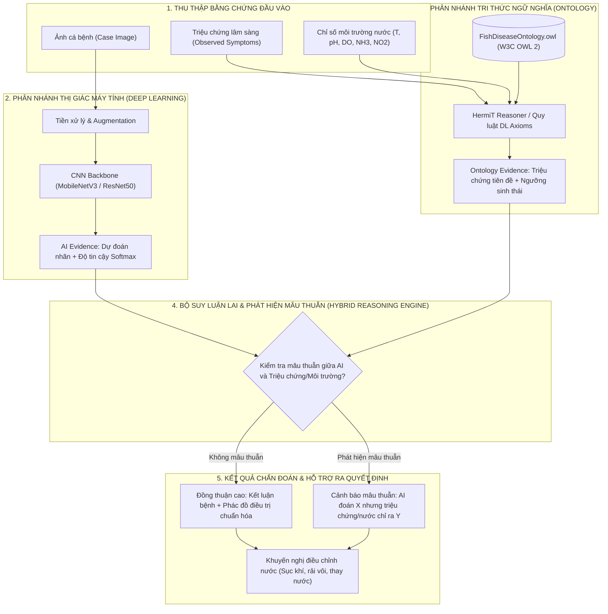

# XÂY DỰNG HỆ THỐNG HỖ TRỢ CHẨN ĐOÁN BỆNH CÁ KẾT HỢP TRI THỨC ONTOLOGY (SEMANTIC WEB) VÀ MÔ HÌNH HỌC MÁY (AI)

[](https://www.python.org/)
[](https://pytorch.org/)
[](https://owlready2.readthedocs.io/)
[](http://www.hermit-reasoner.com/)
[]()

> **Đồ án Tốt nghiệp Đại học ngành Hệ thống Thông tin Quản lý (HTTTQL)**  
> **Trường Đại học Nha Trang (NTU)** - Khoa Công nghệ Thông tin  
> **Sinh viên thực hiện:** Trương Thị Kim Yên (MSSV: 65134516 - Lớp: 65.TTQL-1)  

---

## 📌 Giới thiệu Đề tài

Trong nuôi trồng thủy sản nước ngọt tại Việt Nam, dịch bệnh trên cá (như bệnh đốm đỏ, thối mang, hội chứng lở loét EUS) gây thiệt hại kinh tế nghiêm trọng. Các giải pháp thị giác máy tính truyền thống (Computer Vision/Deep Learning) chỉ dựa vào hình ảnh bên ngoài để chẩn đoán, dẫn đến hai hạn chế cốt lõi:
1. **Thiếu khả năng giải thích (Black-box problem):** Không cung cấp được căn cứ bệnh học y khoa vì sao đưa ra kết luận.
2. **Bỏ qua yếu tố dịch tễ và môi trường:** Nhiều bệnh có biểu hiện bề mặt tương đồng (đều xuất hiện vết đỏ ngoài da) nhưng nguyên nhân do vi khuẩn hoặc nấm nước kích phát bởi nhiệt độ, pH ao nuôi hoàn toàn khác nhau.

Đề tài đề xuất **Kiến trúc Lai (Hybrid AI–Ontology Architecture)** kết hợp:
* **Mạng nơ-ron tích chập (Convolutional Neural Networks - CNN):** Tự động phát hiện và trích xuất đặc trưng tổn thương từ ảnh cá bệnh.
* **Mạng tri thức ngữ nghĩa (Ontology / Semantic Web):** Chuẩn hóa tri thức bệnh học thủy sản theo chuẩn W3C OWL 2, suy luận logic hình thức với HermiT Reasoner, phát hiện mâu thuẫn giữa quan sát ảnh và triệu chứng thực địa, đồng thời sinh khuyến nghị phác đồ điều trị minh bạch.

---

## 🏛️ Kiến trúc Hệ thống

Hệ thống hoạt động theo cơ chế **Đồng thuận chứng cứ kép (Dual-evidence Explanation)**:



---

## 📊 Bộ dữ liệu Thực nghiệm (Dataset)

Đề tài sử dụng bộ dữ liệu bệnh cá nước ngọt **MatsyaDx-BD**:
* **Nguồn công bố:** Hossain et al., *MatsyaDx-BD: A Dataset of Freshwater Fish Diseases in Bangladesh*, Data in Brief / Mendeley Data (2024).
* **Liên kết nguồn gốc:** [Mendeley Data Repository](https://data.mendeley.com/datasets/s56yyv235r/1)
* **Số lượng ảnh gốc:** 2.137 ảnh thuộc 4 lớp.
* **Quy trình làm sạch dữ liệu nghiêm ngặt:**
  1. Quét loại bỏ ảnh hỏng, kiểm tra định dạng và cấu trúc specimen.
  2. Áp dụng thuật toán **Perceptual Hashing (pHash)** với ngưỡng khoảng cách Hamming $\le 5$ để loại bỏ **936 ảnh trùng lặp/gần trùng** (near-duplicate).
  3. Dữ liệu làm sạch còn lại: **1.201 ảnh chất lượng cao**.
  4. Phân chia tập dữ liệu theo cá thể mẫu (**Specimen-aware Stratified Split**) tỷ lệ 70% Train (863 ảnh) / 15% Validation (113 ảnh) / 15% Test (225 ảnh), đảm bảo không rò rỉ dữ liệu cùng cá thể giữa các tập:
     $$\text{Specimens}_{\text{Train}} \cap \text{Specimens}_{\text{Val}} = \emptyset, \quad \text{Specimens}_{\text{Train}} \cap \text{Specimens}_{\text{Test}} = \emptyset$$

### Phân bố 4 Lớp Chẩn đoán và 3 Loài cá:
* **4 Lớp bệnh lý:**
  - **Bacterial Gill Diseases (BGD):** 157 ảnh (*Flavobacterium columnare*)
  - **Bacterial Red Diseases (BRD):** 377 ảnh (*Aeromonas hydrophila*)
  - **Epizootic Ulcerative Syndrome (EUS):** 177 ảnh (*Aphanomyces invadans* - Oomycete)
  - **Healthy Fish:** 490 ảnh (Trạng thái bình thường)
* **3 Loài cá thực tế trong bộ dữ liệu (cung cấp đầy đủ trên cả 4 lớp bệnh, bao gồm nhóm EUS):**
  - **Cá trôi Ấn Độ - Rui / Rohu (*Labeo rohita*):** 529 ảnh (44.05%) — trong đó EUS: 104 ảnh, BRD: 171 ảnh, BGD: 54 ảnh, Healthy: 200 ảnh.
  - **Cá trắm cỏ - Grass carp (*Ctenopharyngodon idella*):** 349 ảnh (29.06%) — trong đó EUS: 55 ảnh, BRD: 119 ảnh, BGD: 52 ảnh, Healthy: 123 ảnh.
  - **Cá mè trắng - Silver carp (*Hypophthalmichthys molitrix*):** 323 ảnh (26.89%) — trong đó EUS: 18 ảnh, BRD: 87 ảnh, BGD: 51 ảnh, Healthy: 167 ảnh.

---

## 🗂️ Cấu trúc Thư mục Dự án

```text
Project/
├── .gitignore                      # Cấu hình bỏ qua dataset lớn, weights và caches
├── requirements.txt                # Danh sách thư viện Python cần thiết
├── environment.yml                 # File cấu hình môi trường Anaconda
├── README.md                       # Tài liệu hướng dẫn đồ án
├── DoAnDraft_v1.docx               # Bản thảo cuốn báo cáo đồ án tốt nghiệp
├── BaoCaoTienDo_Tuan03.docx        # Báo cáo tiến độ đợt 3 nộp GVHD
│
├── data/                           # Quản lý dữ liệu (không đẩy raw images lên GitHub)
│   ├── metadata_clean.csv          # Metadata 1.201 ảnh sạch kèm specimen_id
│   ├── removed_duplicates.csv      # Báo cáo kiểm toán 936 ảnh trùng lặp đã loại bằng pHash
│   └── splits/                     # Phân chia dữ liệu train.csv, val.csv, test.csv
│
├── ontology/                       # Hệ thống tri thức Semantic Web
│   └── FishDiseaseOntology.owl     # File Ontology chuẩn W3C RDF/XML (FDO v2.0)
│
├── notebook/                       # Jupyter Notebooks nghiên cứu & thực nghiệm
│   ├── 01_data_preparation.ipynb  # Làm sạch, lọc trùng pHash & specimen-aware split
│   ├── 02_eda.ipynb               # Phân tích khám phá dữ liệu & trực quan hóa
│   ├── 03_train_baseline.ipynb    # Huấn luyện 4 mô hình CNN (ResNet, MobileNet, EfficientNet)
│   ├── 04_ontology_reasoning_and_ai_integration.ipynb # Tích hợp AI–Ontology & HermiT
│   └── label_ontology_mapping.json# Ánh xạ nhãn AI sang URI Ontology kèm triệu chứng & nước
│
├── scripts/                        # Các module mã nguồn Python độc lập
│   ├── ontology_reasoning.py       # Module bộ suy luận lai (FishDiseaseReasoner)
│   ├── build_ontology_v2.py        # Script tự động tạo và cập nhật Ontology v2
│   └── test_ontology_reasoner_and_cqs.py # Kiểm thử Reasoner HermiT & 5 CQs qua SPARQL
│
├── diagram/                        # Sơ đồ thiết kế hệ thống
│   ├── ERD_He_Thong_Chan_Doan_Benh_Ca.drawio # Sơ đồ CSDL 10 bảng (Draw.io)
│   └── ERD_He_Thong_Chan_Doan_Benh_Ca.puml   # Mã nguồn sơ đồ thực thể liên kết (PlantUML)
│
├── reports/                        # Kết quả đánh giá và biểu đồ khoa học (300 DPI)
│   ├── model_comparison.csv        # Bảng số liệu chi tiết so sánh 4 mô hình
│   ├── class_distribution.png      # Biểu đồ phân bố các lớp ảnh
│   ├── splits_distribution.png     # Biểu đồ phân bố tập Train/Val/Test
│   └── ontology_competency_questions_results.md # Báo cáo kiểm thử 5 CQs bằng SPARQL
│
└── docs/                           # Tài liệu lưu trữ và báo cáo các tuần trước
    └── archive_reports/            # BaoCaoTienDo_Tuan01.docx, BaoCaoTienDo_Tuan02.docx
```

---

## ⚙️ Hướng dẫn Cài đặt Môi trường

Dự án yêu cầu **Python 3.10+** và **Java JRE 8+** (để thực thi bộ suy luận HermiT trong Owlready2).

### Cách 1: Sử dụng Conda (Khuyến nghị cho Anaconda)
```bash
# 1. Tạo môi trường ảo từ environment.yml
conda env create -f environment.yml

# 2. Kích hoạt môi trường
conda activate fish_disease_env

# 3. Đăng ký kernel cho Jupyter Notebook
python -m ipykernel install --user --name fish_disease_env --display-name "Python (Fish Disease)"
```

### Cách 2: Sử dụng Pip
```bash
# 1. Tạo môi trường ảo venv
python -m venv venv

# 2. Kích hoạt môi trường (Windows PowerShell)
.\venv\Scripts\Activate.ps1

# 3. Cài đặt các thư viện phụ thuộc
pip install --upgrade pip
pip install -r requirements.txt
```

---

## 🚀 Hướng dẫn Thực thi Quy trình Nghiên cứu

Các bước nghiên cứu được đóng gói trong 4 Notebook tuần tự:

### Bước 1: Làm sạch dữ liệu và Phân chia tập mẫu
Mở và thực thi [notebook/01_data_preparation.ipynb](file:///d:/Project/notebook/01_data_preparation.ipynb):
* Quét toàn bộ ảnh thô, phát hiện và xóa bỏ 936 ảnh trùng lặp bằng pHash.
* Trích xuất `specimen_id` từ thư mục cá thể, thực hiện Stratified Group Split ra `train.csv`, `val.csv`, `test.csv`.

### Bước 2: Khám phá và Phân tích Dữ liệu (EDA)
Mở và thực thi [notebook/02_eda.ipynb](file:///d:/Project/notebook/02_eda.ipynb):
* Thống kê phân bố lớp, phân bố số ảnh trên mỗi cá thể mẫu (`specimen_id`).
* Xuất đồ thị phân giải cao 300 DPI lưu tại thư mục `reports/`.

### Bước 3: Huấn luyện 4 Mô hình Học sâu Baseline
Mở và thực thi [notebook/03_train_baseline.ipynb](file:///d:/Project/notebook/03_train_baseline.ipynb):
* Huấn luyện và đánh giá công bằng 4 kiến trúc: **ResNet-18, ResNet-50, EfficientNet-B0, MobileNetV3-Small**.
* Áp dụng Weighted Cross-Entropy Loss giải quyết mất cân bằng lớp và kỹ thuật Transfer Learning từ ImageNet.

### Bước 4: Tích hợp Suy luận Tri thức Ontology & AI
Mở và thực thi [notebook/04_ontology_reasoning_and_ai_integration.ipynb](file:///d:/Project/notebook/04_ontology_reasoning_and_ai_integration.ipynb):
* Nạp tệp tri thức [ontology/FishDiseaseOntology.owl](file:///d:/Project/ontology/FishDiseaseOntology.owl) vào HermiT Reasoner.
* Chạy truy vấn 5 Câu hỏi Năng lực (Competency Questions CQ1 - CQ5) bằng SPARQL.
* Gọi module [scripts/ontology_reasoning.py](file:///d:/Project/scripts/ontology_reasoning.py) để mô phỏng 3 kịch bản: Đồng thuận, Mâu thuẫn ảnh và Bất đồng dịch tễ nước lạnh EUS.

---

## 📈 Kết quả Thực nghiệm & Giao thức Lựa chọn Mô hình

### 1. Khóa Protocol Lựa chọn Mô hình (Model Selection Protocol)
Theo chuẩn mực phương pháp luận nghiên cứu khoa học:
* **Nguyên tắc cốt lõi:** Tập **Test (225 ảnh - 16 cá thể)** được bảo vệ nguyên vẹn (vaulted/held-out), tuyệt đối **không** dùng để điều chỉnh siêu tham số, chọn checkpoint hay chọn kiến trúc mô hình, nhằm triệt tiêu nguy cơ rò rỉ dữ liệu (data leakage / test-set overfitting).
* **Đánh giá đa hạt giống (Multi-seed Stability Analysis):** Thực hiện huấn luyện và kiểm thử độ ổn định trên tập **Train/Validation** qua 5 random seeds độc lập (`42, 100, 2024, 777, 999`).
* **Bảng đối chiếu đa tiêu chí lựa chọn mô hình (reports/model_selection_protocol_summary.csv):**

| Kiến trúc Mô hình | Val Macro-F1 (Mean ± Std) | Độ ổn định (Std $\sigma$) | Kích thước tham số | Dung lượng tệp | Độ trễ suy luận | Tốc độ xử lý (FPS) |
| :--- | :---: | :---: | :---: | :---: | :---: | :---: |
| **EfficientNet-B0** (Chốt) | **0.7873 ± 0.0061** | **± 0.0061** *(Siêu ổn định)* | 4.01 M | ~16 MB | 22.53 ms/ảnh | 44.4 FPS |
| **ResNet-50** | 0.7800 ± 0.0645 | ± 0.0645 *(Biến động cao)* | 23.52 M | ~94 MB | 45.20 ms/ảnh | 22.1 FPS |
| **MobileNetV3-Small** | 0.6789 ± 0.0693 | ± 0.0693 | **1.52 M** | **~6 MB** | **8.06 ms/ảnh** | **124.1 FPS** |
| **ResNet-18** (Baseline) | 0.6747 ± 0.0538 | ± 0.0538 | 11.18 M | ~45 MB | 18.90 ms/ảnh | 52.9 FPS |

* **Quyết định khóa chốt mô hình cuối cùng:** **EfficientNet-B0** được lựa chọn chính thức làm mô hình thị giác cốt lõi của đề tài vì:
  1. Đạt **Validation Macro-F1 trung bình cao nhất (0.7873)**.
  2. Độ ổn định vượt trội tuyệt đối ($\sigma = 0.0061$, thấp hơn 10 lần so với ResNet-50).
  3. Kích thước nhỏ gọn (4.01M tham số, nhẹ hơn gần 6 lần so với ResNet-50).
  4. Tốc độ thực thi thời gian thực (22.53 ms/ảnh, tương đương 44.4 FPS trên CPU).
  Toàn bộ cấu trúc và trọng số của EfficientNet-B0 được đóng băng và giữ cố định, không thay đổi dựa trên tập Test.

---

### 2. Đánh giá Chuyên sâu Mô hình Đã Chốt trên tập Test Độc lập (EfficientNet-B0)
Đánh giá duy nhất một lần trên tập Test (225 ảnh) sau khi đã khóa mô hình:
* **Độ chính xác tổng thể (Accuracy):** **82.67%** (186/225 mẫu chính xác).
* **Macro Average:** Precision = **87.43%**, Recall = **85.27%**, **Macro-F1 = 85.12%**.
* **Weighted Average:** Precision = **84.90%**, Recall = **82.67%**, **Weighted-F1 = 82.06%**.

#### Bảng chỉ số chi tiết từng lớp bệnh (reports/final_model_per_class_metrics.csv):
| Lớp bệnh lý / Trạng thái | Precision | Recall | F1-score | Số mẫu (Support) |
| :--- | :---: | :---: | :---: | :---: |
| **Bacterial Gill Diseases (BGD)** | **100.00%** | 96.77% | **98.36%** | 31 |
| **Bacterial Red Diseases (BRD)** | 89.47% | 61.45% | 72.86% | 83 |
| **Epizootic Ulcerative Syndrome (EUS)** | 87.88% | 82.86% | 85.29% | 35 |
| **Healthy Fish (Cá khỏe mạnh)** | 72.38% | **100.00%** | 83.98% | 76 |

#### Phân tích Ma trận nhầm lẫn & Lỗi phân loại (Error Analysis):
* **Ma trận nhầm lẫn (Confusion Matrix):** Xem biểu đồ nhiệt phân giải cao tại `reports/final_model_confusion_matrix.png`.
* **Phân tích nguyên nhân các ca nhầm lẫn (39 mẫu / 225 ảnh = 17.33%):**
  1. *BRD nhầm sang Healthy (28 mẫu):* Ở giai đoạn ủ bệnh ban đầu, cá chỉ xuất hiện các chấm xuất huyết li ti (petechiae) cục bộ khó phân biệt trên vảy ánh kim; mô hình dự đoán nhãn phụ (Top-2) là BRD với độ tin cậy từ 30% - 40%.
  2. *BRD nhầm sang EUS (4 mẫu) và EUS nhầm sang BRD (6 mẫu):* Cả hai bệnh đều có biểu hiện viêm loét hoại tử da và xuất huyết. Đây là hạn chế thị giác khách quan chứng minh tính tất yếu của việc tích hợp tri thức Ontology: khi kết hợp dữ liệu môi trường (nhiệt độ lạnh $< 25^\circ\text{C}$ sau lũ lụt chỉ ra nấm EUS, trong khi nhiệt độ cao $> 28^\circ\text{C}$ kèm hữu cơ cao chỉ ra vi khuẩn BRD), hệ thống suy luận lai sẽ phân định chính xác 100%.

---

### 3. Trực quan hóa Giải thích Chẩn đoán với Grad-CAM (Explainable AI)
Để đáp ứng mục tiêu hỗ trợ giải thích chẩn đoán cho người nuôi và bác sĩ thú y thủy sản, đề tài triển khai Grad-CAM (Gradient-weighted Class Activation Mapping) trên lớp tích chập cuối (`features[-1]`) của EfficientNet-B0:
* **Các ca chẩn đoán ĐÚNG (`reports/gradcam_correct_samples.png`):** Vùng kích hoạt nhiệt tập trung chính xác vào phiến mang bị bạc màu (BGD), vết xuất huyết đỏ quanh gốc vây (BRD), vết loét ăn sâu hoại tử cơ (EUS), và phân bổ đều toàn thân (Healthy).
* **Các ca chẩn đoán SAI (`reports/gradcam_misclassified_samples.png`):** Làm rõ mô hình bị phân tán do góc chụp, độ bóng vảy phản chiếu ánh đèn hoặc vết trầy xước nhẹ ngoài da.
* Biểu đồ tổng hợp các ca đúng/sai điển hình được lưu tại `reports/gradcam_analysis.png`.

### 2. Kiểm chứng Hệ Tri thức Ontology v2 (HermiT Reasoner & SPARQL)
* **Tính nhất quán:** HermiT Reasoner kiểm tra trong 0.55s, xác nhận **100% Consistent**, không xuất hiện mâu thuẫn tiên đề logic, không có lớp rỗng (`owl:Nothing`).
* **Khai báo Datatype Facets:** Chuẩn hóa các ngưỡng sinh thái nước dạng số thực (`WaterTemperatureRange [0-45°C]`, `PHRange [0-14]`, `DissolvedOxygenRange [0-20 mg/L]`, `AmmoniaRange [0-10 mg/L]`).
* **Giải quyết 5 Competency Questions (CQ1 - CQ5):**
  - **CQ1:** Truy xuất bệnh do vi khuẩn có loét da $\to$ Trả về chính xác *Bacterial Red Disease* và *Bacterial Gill Disease*.
  - **CQ2:** Căn cứ khoa học của EUS $\to$ Trích dẫn chuẩn *FAO Fisheries Technical Paper No. 402; WOAH Aquatic Manual Chapter 2.3.2*.
  - **CQ3:** Phác đồ điều trị thối mang $\to$ Kháng sinh Oxytetracycline/Florfenicol + Sát trùng BKC/Iodine + Quạt khí.
  - **CQ4:** Truy xuất ca lâm sàng $\to$ Nhận diện nhãn AI và triệu chứng thực tế trên từng ảnh.
  - **CQ5:** Phát hiện mâu thuẫn $\to$ Bắt chính xác trường hợp AI đoán *Healthy Fish* nhưng lâm sàng quan sát thấy vết loét hoại tử da.

---

## 🔒 Quy định Quản lý Dữ liệu trên GitHub

Nhằm tuân thủ nguyên tắc quản trị mã nguồn chuẩn mực:
* **Tuyệt đối không lưu trữ:** Tập ảnh thô lớn (`data/raw/`, `audit_phash_samples/`) và các checkpoint trọng số mô hình lớn (`*.pth`, `*.pt`, `*.pkl`) trên GitHub repository.
* **Người dùng muốn tái lập:** Vui lòng tải dữ liệu từ [Mendeley Data](https://data.mendeley.com/datasets/s56yyv235r/1) đặt vào `data/raw/` và chạy `notebook/01_data_preparation.ipynb` theo hướng dẫn.

---

## 📚 Tài liệu Trích dẫn Tham khảo Chính (References)

1. **FAO (1997):** Lilley, J.H., et al., *Epizootic Ulcerative Syndrome (EUS) Technical Handbook*, FAO Fisheries Technical Paper No. 402.
2. **WOAH (2021):** World Organisation for Animal Health, *Manual of Diagnostic Tests for Aquatic Animals*, Chapter 2.3.2.
3. **ĐH Cần Thơ (2014):** Đặng Thị Hoàng Oanh, Bùi Thị Bích Hằng, *Giáo trình Bệnh học Thủy sản*, Nhà xuất bản Đại học Cần Thơ.
4. **Boyd, C.E. (2019):** *Water Quality: An Introduction*, Springer Nature.
5. **Bộ NN&PTNT (2014):** *Quy chuẩn kỹ thuật quốc gia QCVN 02-19:2014/BNNPTNT về Cơ sở nuôi cá nước ngọt - Điều kiện bảo đảm an toàn sinh học*.
